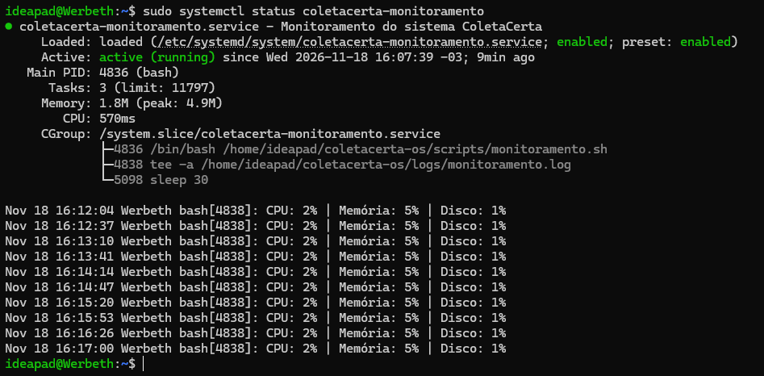
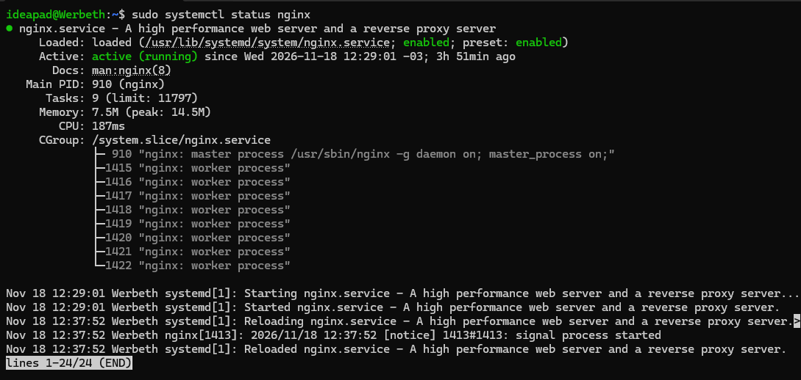
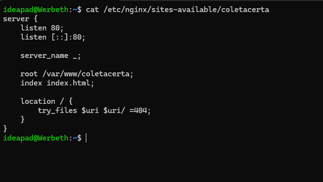
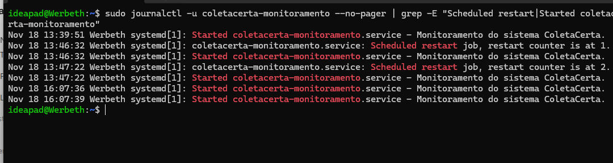
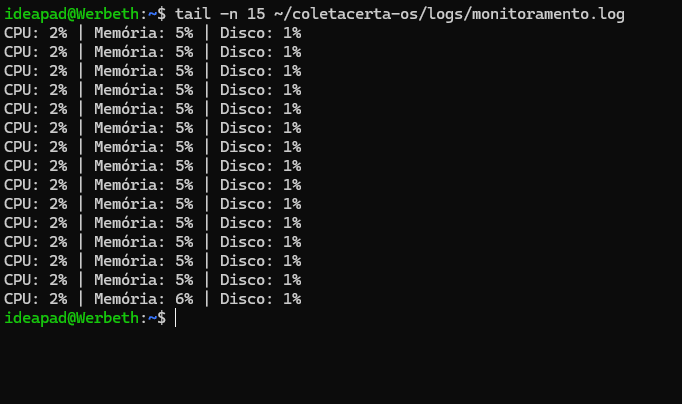
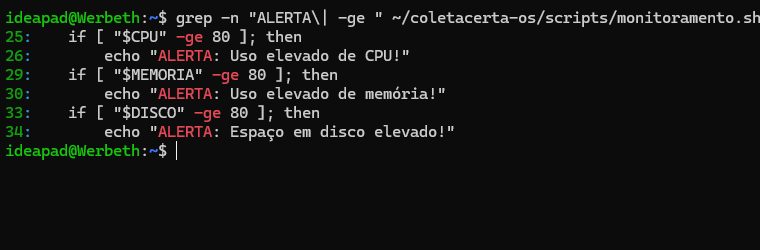
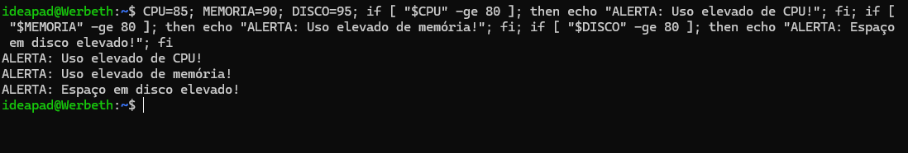
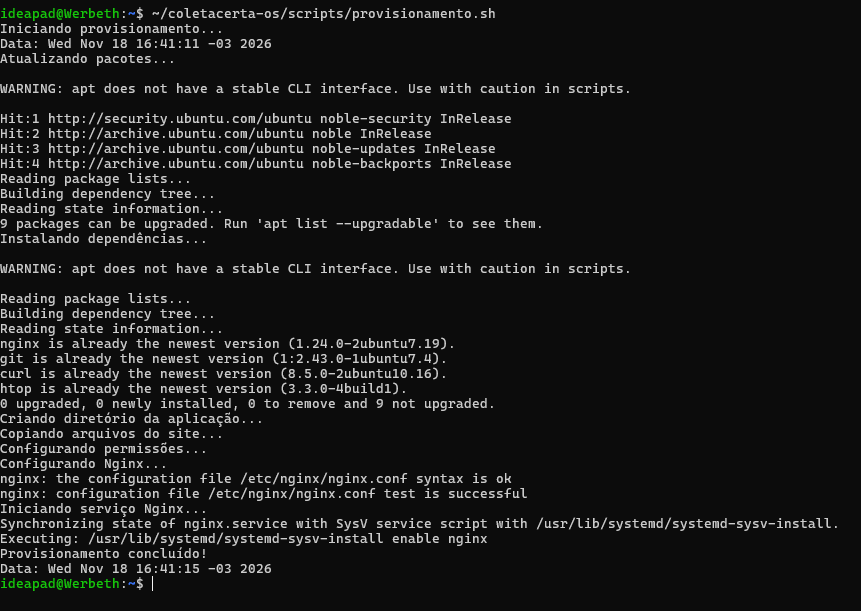

# ColetaCerta — Infraestrutura Linux

## Sobre o projeto

Este repositório contém a infraestrutura Linux desenvolvida para hospedar a aplicação Web do ColetaCerta, projeto acadêmico da FIAP — Global Solution 2026.2.

O objetivo é provisionar e administrar um ambiente Linux, automatizar a instalação e configuração dos serviços e monitorar os recursos do sistema.

## Tecnologias utilizadas

- Ubuntu 24.04 LTS
- WSL 2
- Nginx
- Bash
- systemd
- rsyslog
- Git

## Aplicação hospedada

A aplicação Web institucional do ColetaCerta é servida pelo Nginx, utilizando os arquivos armazenados em:

`/var/www/coletacerta`

A aplicação pode ser acessada localmente pelo endereço:

`http://localhost`

## Estrutura do projeto

- `scripts/`: scripts Bash de provisionamento e monitoramento.
- `services/`: arquivos de configuração dos serviços systemd.
- `config/`: arquivos de configuração da infraestrutura.
- `logs/`: registros de execução e monitoramento.
- `evidencias/`: evidências técnicas e testes realizados.

## Automação e provisionamento

O script `provisionamento.sh` automatiza:

- Atualização dos pacotes do sistema.
- Instalação das dependências.
- Criação do diretório da aplicação.
- Cópia dos arquivos do site.
- Configuração das permissões.
- Validação e inicialização do Nginx.

**Pré-requisitos:** Ubuntu configurado, repositório do site clonado em `~/coletacerta-site` e configuração do Nginx disponível em `/etc/nginx/sites-available/coletacerta`.

## Monitoramento da infraestrutura

O script `monitoramento.sh` realiza coletas periódicas de:

- Uso de CPU.
- Uso de memória.
- Utilização do disco.

As coletas são realizadas a cada 30 segundos e registradas em arquivo de log.

O monitoramento possui alertas configurados para utilização igual ou superior a 80% dos recursos.

## Serviço e recuperação automática

O monitoramento é executado como um serviço gerenciado pelo systemd.

O serviço possui inicialização automática e configuração de reinicialização em caso de falha, utilizando `Restart=always`.

## Logs e auditoria

Os registros são armazenados no diretório `logs/`.

O diário do systemd também é utilizado para acompanhar as inicializações, interrupções, reinicializações e execuções do serviço.

## Testes realizados

- Execução do script de provisionamento.
- Verificação do funcionamento do Nginx.
- Acesso à aplicação Web pelo navegador.
- Coleta de CPU, memória e disco.
- Simulação dos alertas de utilização elevada.
- Interrupção forçada do serviço e verificação da recuperação automática.

## Ambiente de execução

- Sistema operacional: Ubuntu 24.04.5 LTS.
- Ambiente: WSL 2.
- Servidor Web: Nginx.

## Evidências técnicas

As imagens abaixo documentam a configuração, execução e os testes realizados na infraestrutura.

### 1. Serviço de monitoramento ativo

### 2. Servidor Nginx ativo

### 3. Aplicação Web hospedada

### 4. Configuração do Nginx

### 5. Recuperação automática do serviço

### 6. Logs de monitoramento

### 7. Configuração dos alertas

### 8. Testes práticos dos alertas

### 9. Provisionamento automatizado

## Integrantes

| Nome | RM |
|---|---|
| Werbeth Nunes | 559067 |
| Rodrigo Leme | 550266 |
| Thamiris Almeida | 559155 |
| Dayana Ticona | 558023 |
| Larissa Biusse | 564068 |

## Instituição

FIAP - Engenharia de Software

Global Solution 2026.2 — CitizenTech
