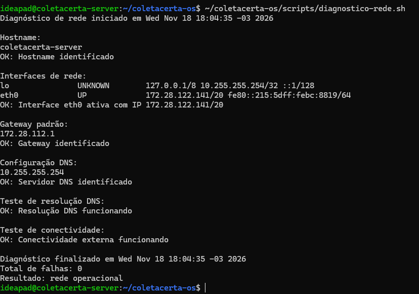
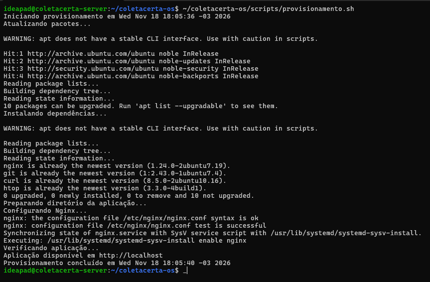
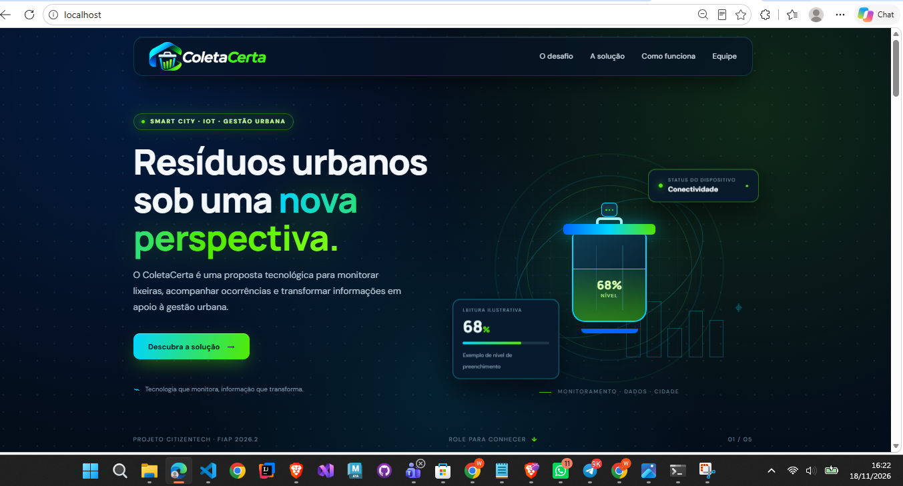
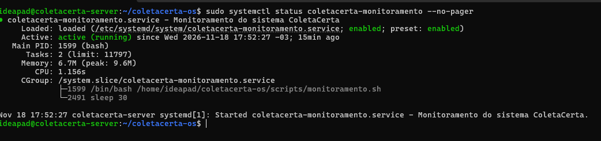
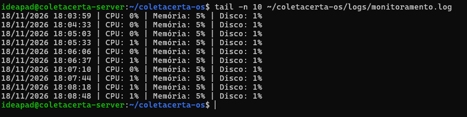
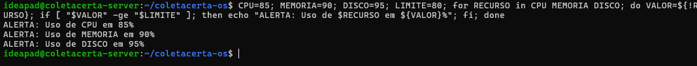
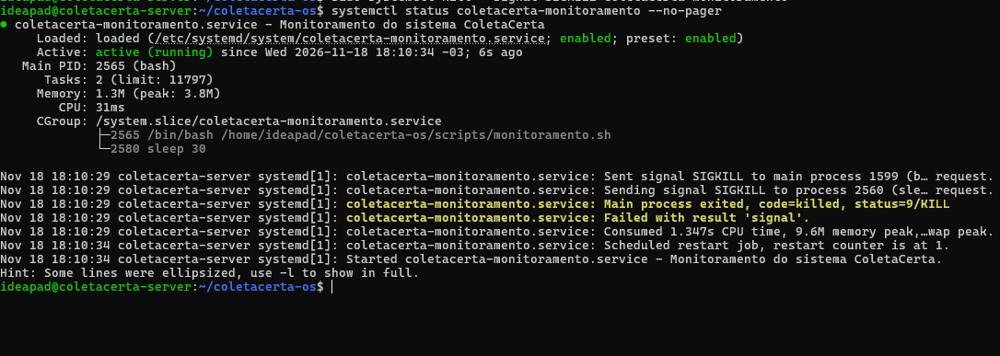
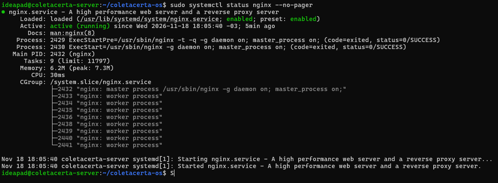
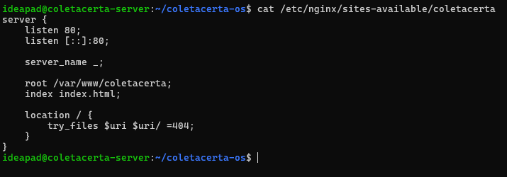

# ColetaCerta — Infraestrutura Linux

## Sobre o projeto

O ColetaCerta é um projeto acadêmico desenvolvido para o Global Solution 2026.2 — CitizenTech, da FIAP, com foco na gestão de resíduos urbanos.

Nesta etapa, o trabalho foi preparar um ambiente Linux para hospedar o site institucional do ColetaCerta. Para isso, configuramos o servidor Nginx, criamos scripts Bash para provisionamento e verificação da rede e implementamos um serviço de monitoramento dos recursos do sistema.

## Tecnologias utilizadas

- Ubuntu 24.04 LTS
- WSL 2
- Bash
- Nginx
- systemd
- Git

## Aplicação hospedada

O site institucional é publicado pelo Nginx. Os arquivos ficam em:

```text
/var/www/coletacerta
```

Com o ambiente em execução, o site pode ser acessado localmente em:

```text
http://localhost
```

## Estrutura do repositório

```text
coletacerta-os/
├── config/
│   └── coletacerta
├── evidencias/
│   └── prints/
├── logs/
├── scripts/
│   ├── diagnostico-rede.sh
│   ├── monitoramento.sh
│   ├── provisionamento-rede.sh
│   └── provisionamento.sh
├── services/
│   └── coletacerta-monitoramento@.service
└── README.md
```

- `config/`: configuração do servidor Nginx.
- `scripts/`: automações de provisionamento, diagnóstico e monitoramento.
- `services/`: unidade parametrizada do systemd para executar o monitoramento.
- `logs/`: registros gerados pelos scripts.
- `evidencias/prints/`: capturas de tela dos procedimentos e testes.

## Requisitos

- Ubuntu 24.04 LTS em ambiente WSL 2.
- Acesso à internet.
- Usuário com permissão para executar comandos `sudo`.
- Git instalado para clonar os repositórios.

## Preparação do ambiente

Clone este repositório no diretório pessoal do usuário:

```bash
git clone https://github.com/werbethnunes/coletacerta-os.git ~/coletacerta-os
cd ~/coletacerta-os
```

O script de provisionamento da aplicação clona o repositório do site automaticamente caso ele ainda não exista em `~/coletacerta-site`.

## Provisionamento da rede

Execute:

```bash
sudo bash scripts/provisionamento-rede.sh
```

O script configura o hostname `coletacerta-server`, habilita o systemd no WSL e verifica os parâmetros de rede disponíveis:

- Interface de rede `eth0`.
- Endereço IPv4.
- Gateway padrão.
- Servidor DNS.
- Resolução de nomes.
- Conectividade externa.

No WSL 2, o endereço IP, o gateway e o DNS são gerenciados pelo próprio ambiente e podem mudar. Por isso, o script identifica e valida esses parâmetros, em vez de definir valores fixos.

Após a execução, reinicie o WSL pelo PowerShell do Windows:

```powershell
wsl --shutdown
```

Abra novamente o Ubuntu e confira o hostname:

```bash
hostname
```

O resultado esperado é `coletacerta-server`.

## Provisionamento do site

Com o terminal aberto no Ubuntu, execute:

```bash
cd ~/coletacerta-os
sudo bash scripts/provisionamento.sh
```

O script:

1. Atualiza a lista de pacotes.
2. Instala Nginx, Git, cURL e htop.
3. Clona o repositório do site, caso ainda não esteja disponível em `~/coletacerta-site`.
4. Copia os arquivos do site para `/var/www/coletacerta`.
5. Ajusta as permissões dos arquivos.
6. Publica a configuração `config/coletacerta` no Nginx.
7. Valida a configuração e reinicia o serviço.
8. Verifica se o endereço `http://localhost` responde.

Para conferir o servidor:

```bash
sudo systemctl status nginx
curl -I http://localhost
```

Uma resposta HTTP `200 OK` indica que o servidor está entregando a página.

## Monitoramento dos recursos

O script `scripts/monitoramento.sh` acompanha o uso de CPU, memória e disco. A coleta ocorre a cada 30 segundos e é registrada em:

```text
logs/monitoramento.log
```

O limite de alerta está configurado em 80%. Quando CPU, memória ou disco atingem ou ultrapassam esse valor, o script registra uma mensagem de alerta no log.

Para executar o monitoramento manualmente:

```bash
bash scripts/monitoramento.sh
```

Para interromper a execução manual, use `Ctrl+C`.

## Serviço de monitoramento com systemd

O arquivo `services/coletacerta-monitoramento@.service` define um serviço parametrizado pelo nome do usuário. Para instalá-lo e iniciar o monitoramento automaticamente:

```bash
sudo cp services/coletacerta-monitoramento@.service /etc/systemd/system/
sudo systemctl daemon-reload
sudo systemctl enable --now "coletacerta-monitoramento@$(id -un).service"
```

O serviço utiliza `Restart=always` e `RestartSec=5`, permitindo que o systemd tente iniciar novamente o monitoramento caso o processo seja encerrado.

Para consultar o estado:

```bash
systemctl status "coletacerta-monitoramento@$(id -un).service"
```

Para acompanhar os registros do serviço:

```bash
journalctl -u "coletacerta-monitoramento@$(id -un).service" -f
```

## Diagnóstico de rede

Para executar as verificações de rede manualmente:

```bash
bash scripts/diagnostico-rede.sh
```

O script registra hostname, interface, IP, gateway, DNS, resolução de nomes e conectividade externa. O resultado também é salvo em:

```text
logs/diagnostico-rede.log
```

## Logs e auditoria

Os scripts registram suas execuções no diretório `logs/`. O systemd mantém também o histórico de inicialização e recuperação do serviço, que pode ser consultado com `journalctl`.

## Testes realizados

Durante a validação do ambiente, foram realizados os seguintes testes:

- Execução dos scripts e validação de sintaxe com `bash -n`.
- Identificação de interface, IP, gateway e DNS.
- Teste de resolução DNS e conectividade externa.
- Reinicialização do WSL e conferência da persistência do hostname.
- Provisionamento do site pelo Nginx.
- Verificação da resposta HTTP em `http://localhost`.
- Verificação do estado do Nginx e do serviço de monitoramento.
- Verificação dos registros de CPU, memória e disco.
- Simulação de condições de alerta.
- Teste de recuperação automática do serviço pelo systemd.

## Evidências

As capturas de tela dos procedimentos e testes estão disponíveis em `evidencias/prints/`.

### 1. Diagnóstico de rede



### 2. Provisionamento



### 3. Site hospedado



### 4. Monitoramento ativo



### 5. Recursos monitorados



### 6. Alertas de monitoramento



### 7. Recuperação automática



### 8. Nginx ativo



### 9. Configuração do Nginx



## Integrantes

| Nome | RM |
|---|---:|
| Werbeth Nunes | 559067 |
| Rodrigo Leme | 550266 |
| Thamiris Almeida | 559155 |
| Dayana Ticona | 558023 |
| Larissa Biusse | 564068 |

## Instituição

FIAP — Engenharia de Software
